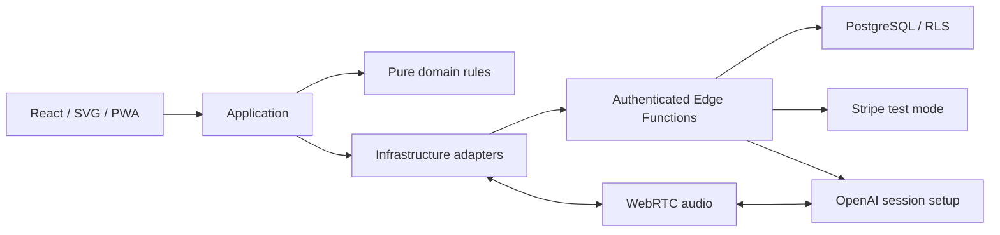

# Architecture

現在の実装、データフロー、信頼境界、変更先、未検証事項は [システムアーキテクチャ仕様書](system-architecture.md) を参照。このページは初期構成の概要として残す。

新規npm workspacesモノレポ。PresentationはReact、生成画像と表示用SVG、設定・共有UI、ApplicationはuseWindow/useConversation/useAccount/useWeather、Domainはpackages/core、外部サービスはservicesとSupabase Edge Functionsへ分離。ZodのAPI契約をpackages/api-contractsで共有する。DomainはReact・Supabase・Stripe・OpenAIに依存しない。

Supabase Authの検証を音声機能に先行させ、秘密情報と会員判定をサーバーへ配置。BYOKはAES-GCMで利用者別に暗号化。音声SDPの統合方式により、標準APIキーをクライアントへ返さない。

ローカルデモは独立したdist-demoとループバックHTTPサーバー。模擬アカウント・課金・定型会話で操作と権限の流れを体験する。実接続ビルド・実APIに模擬認証の入口を含めない。Capacitorは実接続ビルドを同期し、録音権限とアプリ中断処理を含むが実機未検証。

全フェーズの実装は今回のユーザー指示で承認。重要設計の最終レビュー・実サービス検証・本番公開承認は未完了。[ADR](../decisions/0002-connected-phases.md) と [運用条件](../operations/connected-services.md) を参照。
