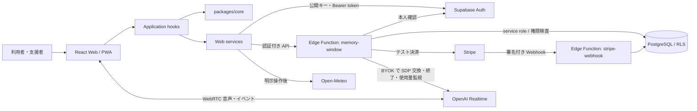
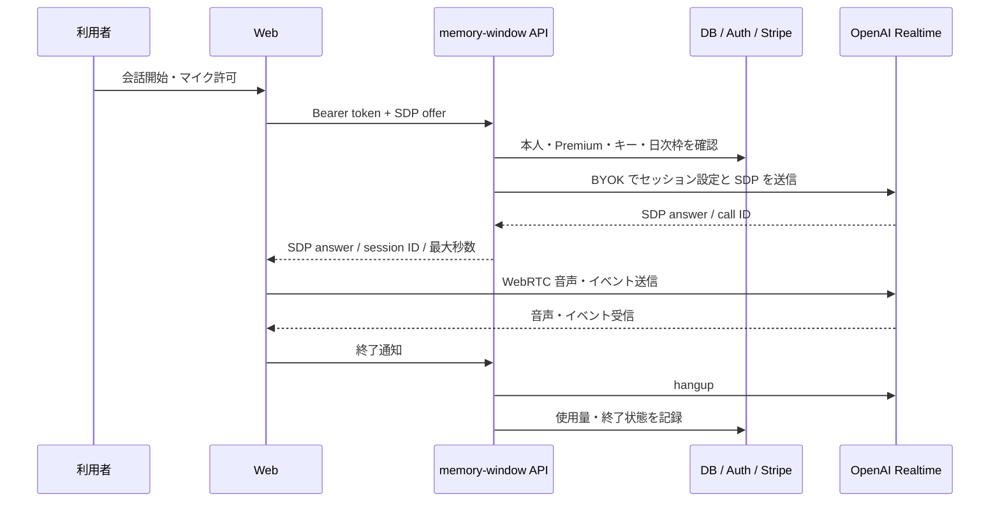

# 思い出の窓 — システムアーキテクチャ仕様書

**状態:** 実装済みコードを記述したレビュー用ベースライン（2026-10-11）。実サービス・実機・本番運用の承認を意味しない。  
**対象:** Web/PWA、ローカルデモ、Supabase 接続、Capacitor プロジェクト。  
**要求の出典:** [SRS v2.0 のフェーズ対応](../specifications/all-phases-plan.md)、[Phase 1 対応](../specifications/phase-1.md)。

## 1. システム境界と構成

このリポジトリは npm workspaces のモノレポである。Web は React/TypeScript と Vite、業務ルールは UI に依存しない TypeScript、実接続 API は Supabase Edge Functions、永続データは PostgreSQL、配布候補は Cloudflare Pages と Capacitor で構成する。Cloudflare とストアへの公開は未実施。

ローカルデモは別の Vite `demo` ビルドとループバック限定の [`scripts/demo-server.ts`](../../scripts/demo-server.ts) を使う。模擬アカウント・会話・課金はデモサーバー内のメモリ上の動作であり、実接続 API には含めない。実接続版は Supabase の公開 URL と公開キーを設定してビルドする。Capacitor は実接続版の Web 資産を同期する。デモ画面の成功は外部サービスの検証結果ではない。

## 2. 責務と変更先

| レイヤー・場所 | 責務 | 主なファイル |
|---|---|---|
| Presentation `apps/web/src` | 窓、生成画像の重ね合わせ、天候表示、人物のコマ切替、時計、操作、管理画面 | [`WindowScene.tsx`](../../apps/web/src/scenes/WindowScene.tsx)、[`Management.tsx`](../../apps/web/src/features/Management.tsx)、[`scene.css`](../../apps/web/src/scenes/scene.css) |
| Application `apps/web/src/application` | ノック・会話・アカウント・天候の操作調整と画面状態 | [`useWindow.ts`](../../apps/web/src/application/useWindow.ts)、[`useConversation.ts`](../../apps/web/src/application/useConversation.ts)、[`useAccount.ts`](../../apps/web/src/application/useAccount.ts)、[`useWeather.ts`](../../apps/web/src/application/useWeather.ts) |
| Domain `packages/core` | 時間帯、人物状態、会話状態、天候コード、候補抽出、閲覧判定などの純粋関数 | [`index.ts`](../../packages/core/src/index.ts)、[`conversation.ts`](../../packages/core/src/conversation.ts) |
| API 契約 `packages/api-contracts` | クライアントと API が受け渡すデータの Zod スキーマ | [`index.ts`](../../packages/api-contracts/src/index.ts) |
| Web infrastructure `apps/web/src/services` | Supabase クライアント、WebRTC、天候 API、端末の音声等 | [`api.ts`](../../apps/web/src/services/api.ts)、[`realtime.ts`](../../apps/web/src/services/realtime.ts)、[`weather.ts`](../../apps/web/src/services/weather.ts) |
| Server `supabase/functions` | 認証・入力検証・所有者確認・秘密鍵・決済・OpenAI 接続 | [`memory-window/index.ts`](../../supabase/functions/memory-window/index.ts)、[`_shared`](../../supabase/functions/_shared)、[`stripe-webhook/index.ts`](../../supabase/functions/stripe-webhook/index.ts) |
| Database `supabase/migrations` | テーブル、RLS、所有者と同意を確認する SQL 関数 | [`202610100001_initial.sql`](../../supabase/migrations/202610100001_initial.sql) |

`packages/core` は React や外部 SDK に依存しない。画面の演出は Presentation に、外部通信と秘密情報はアダプターまたはサーバーに置く。認可の最終判定はブラウザの表示状態に依存させない。

## 3. 主要なデータフロー

### 窓と天候

端末のローカル時刻から時間帯・日付を決め、人物の生活動作と固定挨拶を表示する。ノックは通常 2 回タップ、設定で 1 回タップに変更できる。背景・人物・天候画像は別アセットで、天候は室内画像のガラス部分を透過した背面に描画する。人物画像の状態切替と会話時の拡大は Web 側の表現であり、Live2D のリグではない。詳細は [画像・アニメーション ADR](../decisions/0003-generated-art-animation.md)。

天候は初期 OFF。本人が現在地取得または地域検索を操作したときだけブラウザから Open-Meteo へ送信する。現在地の座標は 0.1 度へ丸め、地域・天候は画面中のメモリだけに保持する。天候取得はバックエンドや会話履歴に保存しない。商用利用条件と対象端末での位置権限は未確認。

### 認証と API

実接続版では Supabase Auth のセッションを使う。Web の [`ApiClient`](../../apps/web/src/services/api.ts) は Bearer token 付きで `memory-window` 関数を呼ぶ。関数の [`context`](../../supabase/functions/_shared/http.ts) は毎回 `auth.getUser(token)` とプロフィールを確認し、入力と Origin を検証する。`verify_jwt=false` は関数内のこの確認を使う設定で、匿名許可を意味しない。DB のサービスロールを使う処理も、検証済み利用者 ID と所有者条件で対象を限定する。クライアントの `role` や `premium` 表示を権限の根拠にしない。

### AI 音声会話

利用者別 BYOK はサーバーで AES-GCM 暗号化して保存する。標準 API キーも短命キーもブラウザに返さない。開始時に Stripe の現在の契約と DB 状態を照合し、1 回 60 秒・UTC 日次 1800 秒を予約する。OpenAI へのセッション作成 POST は自動再試行しない。サーバーのサイドバンド接続でトークン使用量を収集し、終了を試みる。`REALTIME_ENABLED` は既定で false。バックグラウンド監視やネットワーク障害時の確実な停止、実料金は未検証で、アプリ側の秒数だけでは費用上限を保証しない。詳細は [実接続手順](../operations/connected-services.md)。

### 決済と支援者共有

Web のチェックアウト要求は API が受け、Stripe の**テストモード**でセッションを作成する。会員状態は署名検証済み `stripe-webhook` が更新する。Webhook はイベント ID の重複と古いイベントを確認し、Stripe の現行 Subscription を再取得する。実音声開始時にも契約を照合する。価格と実課金は未確定・未実施。

生活ニーズ候補は会話テキストに対する限定的なルールで提示する。自動共有は行わない。本人が項目を非公開で保存し、招待を受けた支援者への共有を版付き同意で明示すると、該当項目だけが閲覧可能になる。編集は共有を解除し、撤回・削除・支援者権限の停止ができる。家族関係だけでは会話や項目を閲覧できない。

## 4. データと信頼境界

| データ | 保存・可視性 | 主な境界 |
|---|---|---|
| 会話音声・全文 | アプリ DB には永続保存しない。音声と一時的な転写は OpenAI へ送られる | プロバイダーの保持条件と本人への説明は公開前に確認 |
| BYOK | `encrypted_api_keys` に暗号文・IV・鍵版。マスター鍵はサーバー秘密設定 | クライアントに秘密鍵を返さない。鍵の更新・削除とローテーションを要レビュー |
| ニーズ項目・同意 | `needs` と `consent_events`。項目は作成から 30 日で閲覧不可 | RLS、所有者判定、版付き同意、有効な支援者権限を併用 |
| 利用技術ログ | `usage_sessions` に時刻・秒数・トークン・エラー種別等 | 会話本文を記録しない。90 日の削除ジョブは未設定 |
| 支援者招待 | `care_invites` にコードのハッシュ、24 時間の期限と一度限りの使用 | 招待と同意は別。支援者の閲覧は共有済み項目だけ |
| 天候・位置 | 画面中のメモリのみ。通信時は Open-Meteo に地域名または丸めた座標を送る | 取得は利用者の明示操作後。送信先には IP も伝わる |

DB では各テーブルの RLS を有効化し、`encrypted_api_keys`・`stripe_customers`・`care_invites`・`stripe_events` にクライアント向けポリシーを設けない。サーバーが service role を使う経路は RLS だけに頼れないため、認証済み利用者 ID、対象所有者、権限をコードと SQL 関数の両方で確認する。期限切れの物理削除には [`schedule-retention.sql`](../../supabase/operations/schedule-retention.sql) の運用設定が必要。実 DB への適用は未実施。

## 5. 配布・検証・レビュー境界

- `npm run demo` は模擬版を `localhost:4174` で起動する。実際の API キーは入力しない。
- `npm run build` は実接続版を `apps/web/dist` に生成する。環境変数、Supabase/Stripe/OpenAI の開発環境とレビューがなければサービス機能は検証できない。
- `npm run mobile:sync` は Web 資産の同期まで。iOS/Android のネイティブビルド、実機マイク、長時間動作、ストア課金は未検証。
- CI は型チェック、Node/Deno テスト、両ビルド、Chromium E2E を定義する。GitHub Actions 上の成功はまだ確認されていない。既存の検証記録は [validation.md](../specifications/validation.md)。
- 認証、RLS、BYOK、決済、同意、外部送信、本番設定の変更は開発者レビューを必須とする。本番デプロイ・実課金・ストア配布の承認は別途必要。

変更時は [共同作業ガイド](../../CONTRIBUTING.md) と [PR テンプレート](../../.github/pull_request_template.md) に従い、影響する境界・実行した検証・未検証事項を明記する。採用理由と代替案は [ADR](../decisions/0002-connected-phases.md) に記録する。
